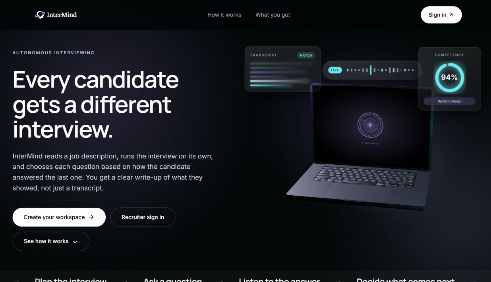
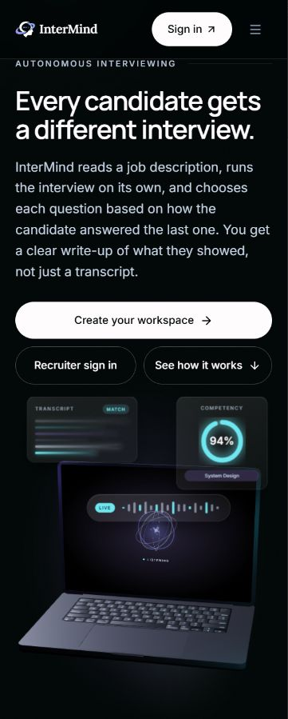
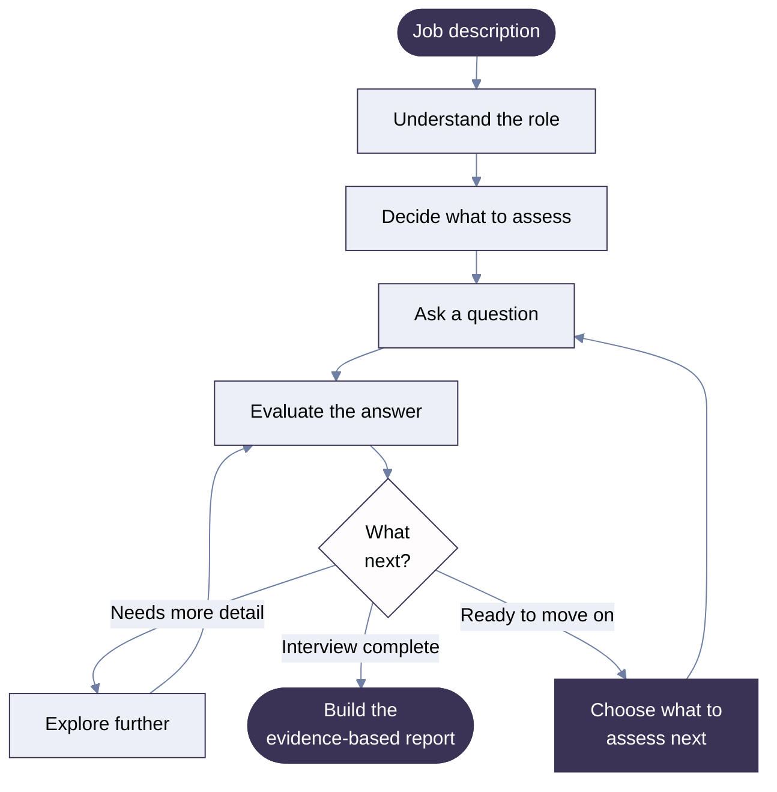
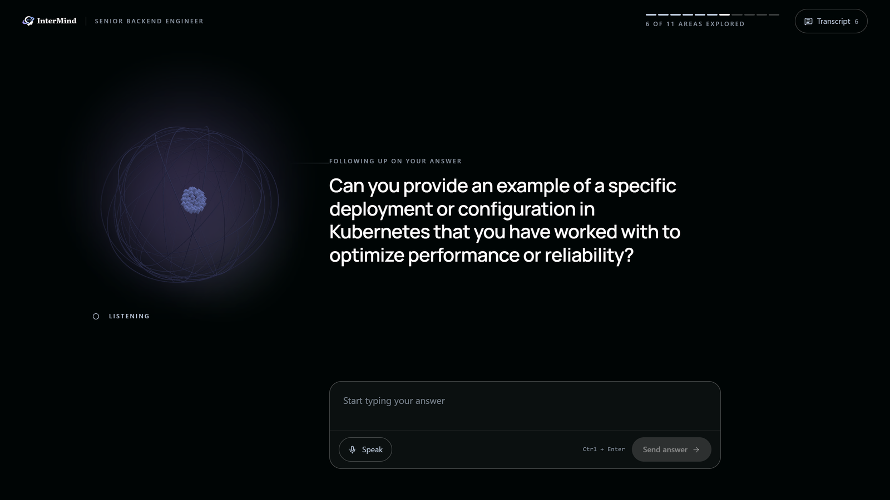
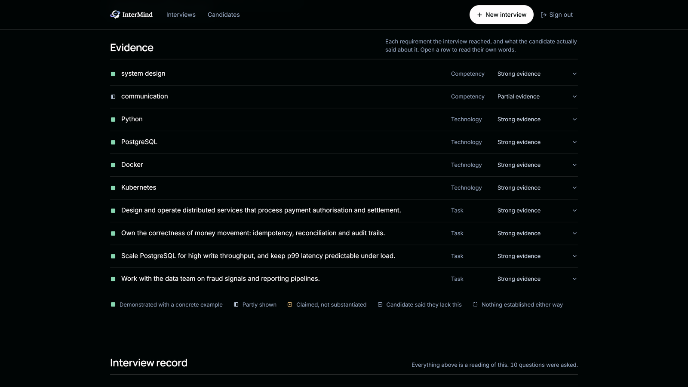
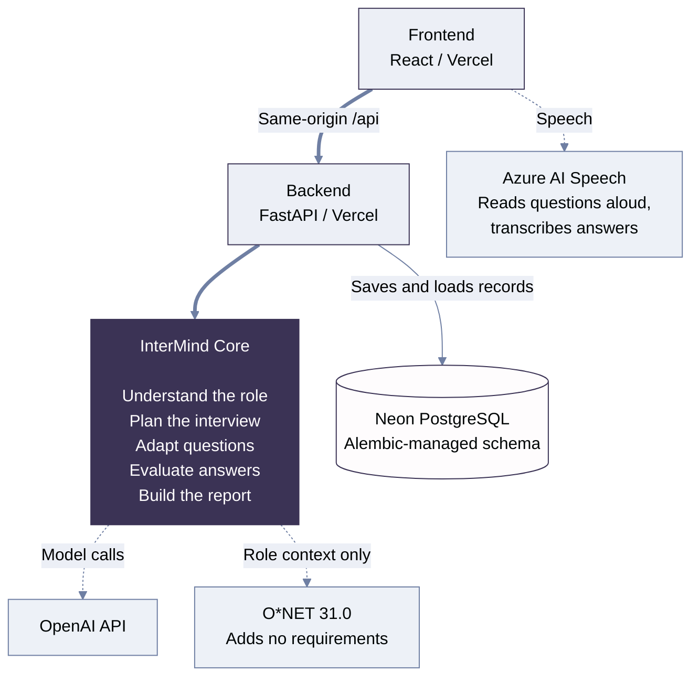

<div align="center">

<picture>
  <source media="(prefers-color-scheme: dark)" srcset="docs/assets/intermind-wordmark-dark.png">
  <source media="(prefers-color-scheme: light)" srcset="docs/assets/intermind-wordmark-light.png">
  
</picture>

### Autonomous AI Technical Interviewer

Adaptive interviews. Evidence-based hiring insight.

**[Live Demo → intermind-ai.vercel.app](https://intermind-ai.vercel.app)**

<p>
  
  
  
  
  
</p>

</div>



## What InterMind is

InterMind turns a job description into an adaptive technical interview and an evidence-based
report. It reads the job description to decide **what the interview should assess**: the
competencies, technologies and tasks the role needs. Filtered occupational context from O\*NET
helps inform the interview without adding extra requirements.

Those assessment areas are set before the conversation starts; question wording, their order and
follow-up behavior adapt at runtime. After each answer, InterMind records structured evidence and
decides whether to explore further or move to another area. Recruiters can trace every assessment
back to what the candidate said.

The public application runs on **Vercel for the frontend and FastAPI backend, with PostgreSQL on
Neon**. The former Azure backend and database are retained for a guarded rollback; any
post-cutover writes need reconciliation first.

<details>
<summary>Production landing page on mobile</summary>

<p align="center">
  
</p>

</details>

Every interview starts with a job description. Before building the interview, the recruiter reviews
what InterMind understood from it.


## Features

- **Job-aware interview planning.** Extracts the role, requirements and assessment areas from a job description for recruiter review.
- **Adaptive interviewing.** Generates questions at runtime and decides whether to follow up or move on based on recorded evidence.
- **Candidate sessions.** Provides shareable interview links with isolated candidate access and persistent progress.
- **Speech support.** Azure AI Speech narrates questions and transcribes answers, with typed input always available.
- **Evidence-based reports.** Turns recorded evaluations into requirement assessments, scores and a recruiter-facing report.


## How the adaptive interview works



The loop is a LangGraph state machine compiled in `backend/app/agents/interview_graph.py`,
suspended on a human-in-the-loop `interrupt` at each question to wait for the candidate's answer.
Selection uses assessment priorities and budget rules; each area allows at most one follow-up.



The follow-up label makes the routing decision visible. The counter tracks assessment areas rather
than a fixed sequence of questions.

## Evidence-based evaluation

Each answer produces structured evidence, strengths, weaknesses and a score. InterMind aggregates these evaluations into requirement assessments and an overall result, then builds the report narrative around them.



Unassessed requirements do not affect the score. Explicit evidence that a candidate lacks a requirement can.

## Measured results

The occupation-retrieval and grounding stages are deterministic, so they are measured offline
against 30 labelled job descriptions - no API key, no model calls. Full methodology, per-case
results and limitations are in [evaluation](docs/evaluation.md).

| | |
| :--- | :--- |
| Occupations indexed | 1,016 |
| Retrieval success@1 / @5 / @10 | 33.3% / 86.7% / 96.7% |
| Median rank of the correct occupation | 2 |
| Retrieval latency (p95, per match) | 6.8 ms |
| Index build at startup | ~650 ms |
| Legacy count of wrong-match O\*NET annotations (includes JD corroboration) | 3 of 30 cases; not a count of new requirements |
| O\*NET tasks contributed by a misidentified occupation | 0 |

Three findings are worth stating plainly rather than burying. **Lexical retrieval ranks the right
occupation first in only a third of cases** - but its median rank is 2 and it is within the top 10
for 96.7%, so this is ranking calibration, not a failure to represent occupations. **The largest
single cause is measured, not guessed:** the query concatenates every JobSpec field into one bag of
words, so four sentences of responsibilities outweigh the role title - dropping that field alone is
worth +10 pp recall@1, which makes field weighting the cheapest available fix. **The macro grounding
gate passed 13 of 20 wrong matches** (precision 40.9%, recall 90.0%, F1 56.3%) and a full threshold
sweep shows it cannot be retuned into shape - ROC-AUC 0.600 means its signal barely separates right
matches from wrong ones. The current planner selects requirements only from the JD. O\*NET may
corroborate an existing requirement (`BOTH` provenance), but cannot add one. The legacy grounding
metric counted corroboration as leakage; the corrected harness separates those concepts. Wrong
occupation context can still influence question wording, which this offline metric does not score.

The separate **historical OpenAI evaluation** used 90 follow-up cases and 15 scripted candidate
personas across five job descriptions. The original v1.0 run was interrupted; retained outputs and
later recovery experiments produced these results:

| Historical metric | Result |
| :--- | :--- |
| Evidence traceability within the reviewed evidence-string scope | 239/239 supported |
| Follow-up F1 | 0.8852459 on 90 cases |
| Server-side next-question P95 | 3.834 s over 100 retained requests |
| Discrimination acceptance gate | Passed on the authored strong/mixed/weak personas |
| Recommendation stability | Explicitly deferred |

These are historical experiments, **not measurements of the current production deployment**.
Traceability does not establish that every report claim or score is correct. The experiments do
not establish hiring accuracy, fairness, or predictive validity. See
[evaluation scope and provenance](docs/evaluation.md#historical-openai-evaluation) for methods,
review limitations, and the distinction between public code and private evaluation inputs.

## Architecture



Production uses Neon PostgreSQL with an Alembic-managed schema; local development can use in-memory storage. Vercel serves the frontend and rewrites same-origin `/api` requests to the separate Vercel-hosted FastAPI backend. The browser keeps its recruiter session cookie on the frontend origin. Recruiter sessions and rate-limit events live in PostgreSQL, so function restarts do not reset them.

**Access and Speech.** Recruiter workspaces are isolated by account ownership, while candidates use an interview-specific access token. Azure AI Speech handles question narration and answer transcription through short-lived authorization issued by the backend. Typed input remains available when Speech is unavailable. See [recruiter authentication](docs/recruiter-auth.md) and [public launch security](docs/public-launch-security.md) for implementation details.

## Tech stack

| Layer | Technologies |
| :--- | :--- |
| Frontend | React 19.3, TypeScript 6.0, Vite 8.3, Tailwind CSS 4.3, React Router 7.18, Motion 13.4, Three.js 0.186 |
| Backend | FastAPI 0.141, Uvicorn 0.52, Pydantic 2.13 |
| AI and orchestration | LangGraph 1.2, OpenAI SDK 3.6, versioned Markdown prompts, structured Pydantic outputs |
| Knowledge | O\*NET 31.0 covering 1,016 occupations, scikit-learn 1.9 for TF-IDF and cosine similarity |
| Persistence | PostgreSQL via SQLAlchemy 2.0 async ORM, asyncpg 0.31, Alembic 1.20 |
| Cloud hosting | Vercel frontend with FastAPI functions in Frankfurt; Neon PostgreSQL in Frankfurt. Azure App Service and PostgreSQL are retained for rollback. |
| Speech | Azure AI Speech for question narration and transcription; browser Web Speech API as fallback; typed input |
| Quality | pytest 9.1, Vitest 5.0, Ruff 0.16, oxlint 1.82 |

Backend deployment versions are pinned in `backend/requirements.txt`; `backend/pyproject.toml`
declares minimum bounds. Frontend resolved versions are recorded in `frontend/package-lock.json`.

## Getting started

Requires **Python 3.11+** and Node.js **`^22.12.0 || ^24.0.0 || >=26.0.0`**. PostgreSQL is optional for local development.

Clone the repository and install the backend:

```bash
git clone https://github.com/AliyahAlabdali/InterMind.git
cd InterMind

python -m venv .venv
source .venv/bin/activate      # PowerShell: .\.venv\Scripts\Activate.ps1

cd backend
pip install -e ".[dev]"
cp .env.example .env          # PowerShell: Copy-Item .env.example .env
```

Install the frontend:

```bash
cd ../frontend
npm ci
cp .env.example .env          # PowerShell: Copy-Item .env.example .env
```

`LLM_PROVIDER=fake` supports credential-free local development. For real model calls, set `LLM_PROVIDER=openai` and `OPENAI_API_KEY`. Never place secrets in `VITE_` variables.

The O\*NET knowledge base is already included in the repository. See [backend/data/README.md](backend/data/README.md) for its source and regeneration process.

For PostgreSQL, set `DATABASE_URL` and run `alembic upgrade head` from `backend/`. Without it, local development uses in-memory storage.

Start the application in two terminals:

| Terminal | Working directory | Command |
| :--- | :--- | :--- |
| Backend | `backend/` | `uvicorn app.main:app --reload` |
| Frontend | `frontend/` | `npm run dev` |

The API runs at `http://127.0.0.1:8000` and the frontend at `http://localhost:5173`.

## Verification

| Check | Working directory | Command |
| :--- | :--- | :--- |
| Public-checkout backend tests | `backend/` | `python -m pytest -q -m "not private_history"` |
| Full backend tests (private historical inputs required) | `backend/` | `python -m pytest -q` |
| Active backend lint | `backend/` | `ruff check app tests scripts alembic evals/run_grounding_eval.py` |
| Frontend tests | `frontend/` | `npm test` |
| Frontend types | `frontend/` | `npm run typecheck` |
| Frontend lint | `frontend/` | `npm run lint` |
| Frontend build | `frontend/` | `npm run build` |
| Retrieval evaluation | `backend/` | `python -m evals.run_retrieval_eval` |
| Grounding evaluation | `backend/` | `python -m evals.run_grounding_eval` |
| Retrieval diagnostics | `backend/` | `python -m evals.diagnose_retrieval` |
| Gate classifier metrics | `backend/` | `python -m evals.run_gate_metrics` |

The October 27, 2026 audit passed **842 backend + 242 frontend = 1,084 tests** (plus three backend
subtests), covering the interview flow, scoring, access control, tenant isolation, UI flows and
Speech integration behavior. The subsequent local remediation check passed **850 backend + 242
frontend = 1,092 tests**, plus three backend subtests. Of the 850 backend tests, 785 are selected
by the public-checkout command and 65 require private historical inputs.
External provider interactions are mocked and do not verify live service availability.

A public checkout excludes ignored historical answers, traces, and reviews. Use the public-checkout
command above; with the authorized private bundle restored, first run
`python -m evals.private_history --check-only`, then the full suite. See
[historical provenance](backend/evals/recovery_v11/HISTORICAL_PROVENANCE_v1.2.md).
The active lint command excludes frozen historical source snapshots, which retain their original
lint findings. The four offline retrieval/grounding commands report measurements rather than
asserting acceptance; they need no credentials. Historical live evaluation runners are separate
and incur OpenAI charges when executed.

## Current limitations

- Reports are generated when results are first accessed rather than immediately when an interview ends.
- Password recovery, email verification and shared team workspaces are not currently included.
- Speech authorization limits credential issuance, but cannot cap Azure audio consumption after a credential has been issued.

See [public launch security](docs/public-launch-security.md) and [deployment notes](docs/deployment.md) for operational details.

## Documentation

- [Deployment](docs/deployment.md)
- [Recruiter authentication](docs/recruiter-auth.md)
- [Public launch security](docs/public-launch-security.md)
- [Evaluation](docs/evaluation.md)

## Author

Built by **Aliyah Alabdali**.

<p>
  <a href="https://github.com/AliyahAlabdali" title="Aliyah Alabdali on GitHub"></a>
  &nbsp;&nbsp;
  <a href="https://www.linkedin.com/in/aliyah-alabdali-5ba599274/" title="Aliyah Alabdali on LinkedIn"></a>
  &nbsp;&nbsp;
  <a href="https://aliyahalabdali.github.io" title="Aliyah Alabdali's Portfolio"></a>
  &nbsp;&nbsp;
  <a href="mailto:AliyahAlabdali24@gmail.com" title="Email Aliyah Alabdali"></a>
</p>

<sub>O\*NET data is published by the U.S. Department of Labor and is redistributed here under
their terms of use; `backend/data/processed/onet/onet_kb.jsonl` is derived from O\*NET 31.0. The hero laptop model is by <a href="https://sketchfab.com/3d-models/realistic-3d-laptop-model-high-quality-design-920fe8eceaf748a5b9ddd53385519322">Taohid Animation</a>, used under CC BY 4.0.</sub>
